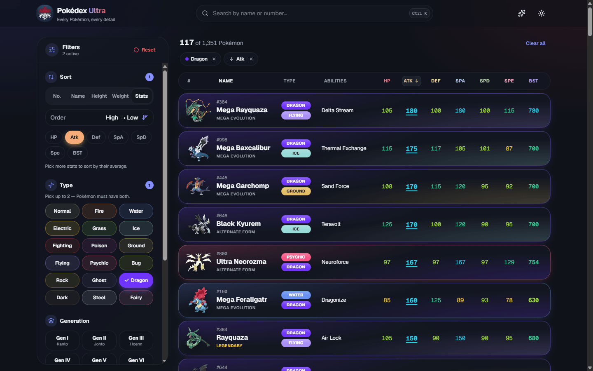
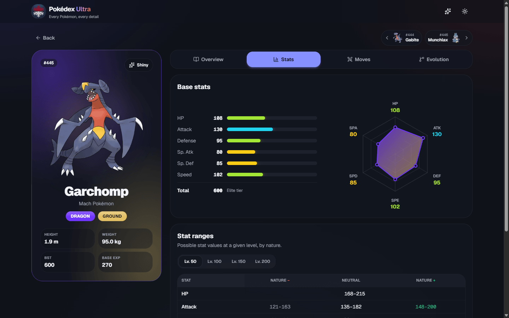

# Pokédex Ultra

Pokédex web focada em **profundidade de dados** e **ferramentas de análise** — além de listar Pokémon, ela ajuda a comparar stats, filtrar o catálogo inteiro e entender matchups, evoluções e movesets com clareza. Funciona como PWA instalável e offline.

Dados via [PokéAPI](https://pokeapi.co/).

## Preview

**Catálogo com filtros avançados** — stats, BST, tipos e habilidades visíveis na lista; filtros por geração, tipo, golpes e ordenação por stats.



**Página de detalhe** — radar, barras de base stats e faixas min/máx por nível com naturezas.



## Por que é mais completa

| Área | O que entrega |
|---|---|
| **Catálogo** | ~1.350 Pokémon e formas numa lista virtualizada (rolagem fluida até o fim), com stats, BST, tipos e habilidades na mesma linha |
| **Filtros** | Tipo (até 2), geração, golpes (até 4, combobox com busca), formas alternativas e ordenação por número, nome, altura, peso ou stats (média de vários) |
| **Busca** | Nome, nome oficial ou número (`Ctrl/⌘+K`), palavras em qualquer ordem ("mega x") |
| **Detalhe** | Hero com arte, Shiny, anterior/próximo (botões, setas do teclado ou swipe) e abas Overview, Stats, Moves e Evolution |
| **Stats** | Barras e radar animados, faixas min/máx por nível (50–200) e natureza |
| **Type defenses** | Fraquezas, resistências e imunidades agrupadas |
| **Moves** | Por jogo (DLCs incluídos), busca, filtro por categoria, TM/HM/TR corretos, valores da época e efeito ao tocar |
| **Evolução** | Condições atuais legíveis, evoluções regionais (Alolan Raichu…) e Megas/Gigantamax/formas |
| **Sprites** | Arte oficial ou pixel art, com toggle global |

## Funcionalidades em destaque

- Filtros e posição da lista preservados ao abrir um Pokémon e voltar
- Transição "morph" do sprite da lista para o detalhe (View Transitions)
- Habilidades com descrição no hover (lista) e inline (detalhe)
- Offline: catálogo, golpes e Pokémon já visitados abrem sem rede
- Tema claro/escuro com transição circular; respeita "reduzir movimento"

## Stack

Next.js 16 · React 19 · TypeScript · TanStack Query · TanStack Virtual · Tailwind CSS 4 · Base UI (shadcn) · Framer Motion · Serwist · PokéAPI

## Como rodar

Requisitos: **Node.js 20+** e **npm**.

```bash
git clone https://github.com/Bruno-Piter/pokedex-ultra.git
cd pokedex-ultra
npm install
npm run dev   # na primeira vez gera public/data (~30 s)
```

Abra [http://localhost:3000](http://localhost:3000).

```bash
npm run build         # produção (gera/reaproveita os dados antes)
npm run start         # servir build
npm run lint          # ESLint
npm run typecheck     # TypeScript
npm test              # Vitest
npm run data:build    # gera public/data (usa cache de até 7 dias)
npm run data:refresh  # força nova geração a partir da PokéAPI
npm run icons         # regera favicon e ícones PWA a partir de scripts/source-icon.png
```

## Dados e performance

A PokéAPI é consultada **no build**, não no navegador, para tudo o que é estático:

- `scripts/build-data.mjs` gera `public/data/catalog.json` (Pokémon, formas, nomes oficiais, stats, habilidades com descrição, golpes aprendíveis), `moves.json` (todos os golpes, TM/HM/TR por jogo, valores antigos) e `manifest.json` (hash de versão).
- O resultado fica em `.next/cache/pokedex-data` por 7 dias — a Vercel preserva essa pasta, então os builds seguintes não chamam a PokéAPI.
- O cliente baixa os arquivos com `?v=<hash>`; o Service Worker guarda cache-first e só baixa de novo quando os dados mudam.
- No detalhe, só learnset, species e cadeia evolutiva vêm da PokéAPI (uma requisição cada, em paralelo, com timeout e retry).

## Progressive Web App

Produção usa Serwist (em desenvolvimento o worker fica desligado).

- Cache-first para respostas da PokéAPI, sprites e dados versionados: Pokémon já visitados funcionam offline.
- Aviso discreto de offline/reconexão; o app não recarrega sozinho quando a rede oscila.
- Ícones com transparência real e ícone maskable para Android.

**Como instalar:** Chrome/Edge (desktop) pelo ícone na barra; Android pelo menu do navegador (Chrome ou Samsung Internet); iOS Safari via Compartilhar > Adicionar à Tela de Início.

## Estrutura

```
src/
├── app/                   # rotas (App Router), service worker, manifest
├── components/            # layout (header, busca, toggles), feedback e ui/
├── features/pokemon/
│   ├── api/               # PokéAPI + definições de queries
│   ├── components/        # catalog/ (lista), detail/ (detalhe), filters/
│   ├── hooks/ state/      # dados do detalhe, store da lista
│   └── utils/             # filtros, tipos, golpes, evoluções, stats
├── lib/data/              # catálogo e golpes estáticos (public/data)
└── providers/             # tema, cache, PWA, animação
scripts/build-data.mjs     # gera os dados estáticos
```

## Autor

**Bruno Piter** — [GitHub](https://github.com/Bruno-Piter)

---

Pokémon © Nintendo / Game Freak / The Pokémon Company. Dados via [PokéAPI](https://pokeapi.co/).
